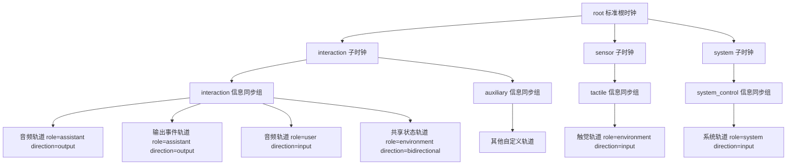

# 标准根时钟、子时钟、信息同步组与轨道

状态：当前架构设计草案；日期：2026-11-16。本章定义时钟、信息同步组和轨道的通用规则；配置示例用于说明设计，配套线协议 Schema 与运行时尚待实现。

A2RT 使用标准根时钟统一时间刻度和数据计量单位，通过子时钟组织不同节拍，通过信息同步组组织同步信息帧，通过自定义轨道承载具体内容。根时钟 ID 固定为 `root`。角色和方向只定义在轨道上，时钟与信息同步组均不定义角色或方向。每个会话配置必须且只能有一条[system 系统轨道](./04-system-track-and-lifecycle.md)，固定为 `role=system`、`direction=input`，其信息同步组归属由 Profile 选择；模型结束信号走 assistant 输出轨道。Core 提供通用时间、承载和交付机制；播放、恢复、同步完整性判断与内容校验由 Profile 定义，具体边界见[第 03 章](./03-core-profile-responsibilities.md)。

**信息同步组（Synchronization Group，简称同步组）**将需要按共同时间窗口组织和处理的信息归为一组。时钟负责更新节拍及时间换算，同步组负责轨道成员的同步组织关系；同一时钟可以供多个独立同步组复用，使用同一时钟、相同频率或共享祖先均不会自动产生跨组等待。同步组的完整性与交付条件由 Profile 定义，“同步”不表示所有成员必须无条件等齐，也不表示每个信息帧必须触发一次模型推理。

**设计目的：根据实际能力确定信息更新和承载节拍，在约定工作范围内控制延迟、减少同步等待并避免持续积压。** 根时钟、标准帧规格、每周期容量、子时钟和信息同步组预算共同形成调度约定；时间坐标换算是其中一项能力。配置需要由运行时及传输绑定落实，不能只用于给无限制产生和发送的数据标记时间。

## 1. 分层与绑定关系

| 对象 | 职责 | 关系 |
| --- | --- | --- |
| 标准根时钟 | 共同时间原点、根据实际能力选择的根频率、标准帧规格及容量基准 | 每个会话 epoch 恰好一个，ID 为 `root` |
| 子时钟 | 通过相对于父时钟的周期比例与起点偏移，组织不同内容的更新节拍 | 每个子时钟一个父时钟，最终可换算到 `root` |
| 信息同步组 | 身份、绑定时钟与窗口起点，组织需要同步处理的轨道；关联 Profile 交付策略和资源限额 | 每个信息同步组只绑定一个时钟，一个时钟可供多个独立信息同步组复用 |
| 轨道 | 信息角色、流向、格式、来源及内容处理规则 | 每条轨道绑定一个信息同步组，一个信息同步组可包含多条轨道 |

轨道只引用 `sync_group_id`，通过信息同步组继承时钟，不重复声明另一套逻辑时钟。信息同步组可以直接绑定 `root`，也可以绑定子时钟。角色和流向不能从时钟、信息同步组或轨道名称推断。



图中连线表示派生或绑定关系，不表示数据发送方向。时钟树和信息同步组绑定不增加新的参与者、角色或传输通道。`environment` 是示例 Profile 声明的扩展角色，用于普通环境数据；系统通知进入唯一的 system 输入轨道。图中为 system 选择独立信息同步组只是该示例的配置，其他 Profile 可以将其绑定到与媒体或状态共用的信息同步组。

## 2. 标准根时钟

### 2.1 属性

| 属性 | 含义与约束 |
| --- | --- |
| `clock_id` | 固定字符串 `root`，大小写敏感、不可配置别名 |
| `frequency_hz` | 每秒根周期数，大于 0；不是视频帧率或音频采样率 |
| `origin` | 根刻度 0 的共同时间原点；可用会话起点，真实设备与它的映射由绑定层记录 |
| `standard_frame_bytes` | 一个标准逻辑帧单位的字节数，正整数 |
| `size_scope` | 计量范围；本方案使用 `a2rt_frame`，包含序列化后的 A2RT 帧头、元数据、分片信息及载荷，不含底层传输头 |
| `standard_frames_per_tick` | 每个根周期约定的标准帧单位容量，正整数 |

`root` 是会话 epoch 内唯一、保留的时钟 ID。根时钟没有父时钟；子时钟不能使用 `root`，也不能通过大小写替换创建另一个根。缺少根、存在多个根、重复 ID 或未最终连到根的时钟均为无效配置。

根频率与帧规格由 Profile 或会话协商确定，不在 Core 中固定为某个数值。选取依据可以包括网络、本地通信、传感器、计算、执行器和任务的时间精度需求。单包到达耗时只是可能的测量输入之一，不是根时钟的通用定义，也不能直接代替持续承载能力。

根时钟定义时间表达与基础调度粒度，并与标准帧规格、每周期容量一起约定可持续承载的节拍。各轨道、推理和执行过程可通过子时钟及 Profile 规则采用适合自身能力的周期，不必每个根周期完成一次工作。具体实现负责确认资源能够满足约定，并按预算组织生产、发送和消费。

### 2.2 标准帧单位、轨道数据帧与组信息帧

**标准帧单位**用于容量计量和分片；**轨道数据帧**是一条轨道在一个周期内提交的一份逻辑数据；**组信息帧**是该组同一周期内不同轨道数据帧的集合，可以占用多个标准帧单位。信息帧按 `(epoch, sync_group_id, frame_seq)` 在会话内定位；内部每个数据帧分别通过自己的 `track_id` 引用所属轨道，该轨道必须绑定到信息帧所属信息同步组。信息帧整体不归属于单条轨道，不能用一个帧级 `track_id` 代表所有成员。

**每条轨道每个周期最多只能有一个数据帧。这是 Core 的硬性约束，Profile 和 Binding 均不能放宽。** 周期指轨道所属信息同步组由绑定时钟划分的窗口，对应一个 `frame_seq`；不是每个根刻度，也不是消息实际到达时所在的周期。在同一会话内，`(epoch, sync_group_id, frame_seq, track_id)` 确定唯一的数据帧位置。同一位置不能追加第二个不同数据帧，不能通过更换消息 ID、发布来源、方向或封装批次绕过限制。

“最多一个”允许零个数据帧。没有数据时是否允许缺省、如何表达空值或保持、是否满足交付条件由 Profile 定义；若为空值或保持实际提交了一个数据帧，它同样占用本周期的唯一位置，不能再追加另一帧。下一份新数据帧使用下一周期或后续周期；等待、迟到及补交不改变原数据帧的周期身份，也不能将已采集内容伪装成新时刻产生。

例如一个信息帧可以包含音频、图片和状态三个数据帧，分别来自三条不同轨道；Profile 若选择 system 同组，还可包含该唯一 system 轨道的一个数据帧。Profile 定义每份载荷的内部结构和业务语义，不得把同轨同周期多个独立数据帧包装成所谓批次，以获得额外帧名额。Binding 定义封装和分片，不能将分片分别当作新数据帧交付。以上逻辑单位均不等于视频帧、音频采样或网络数据包。

| 情况 | 是否满足本约束 |
| --- | --- |
| 同一周期中，音频轨道与图片轨道各一个数据帧 | 满足；不同轨道各有一个位置 |
| 同一轨道在周期 7 和周期 8 各一个数据帧 | 满足；两个位置对应不同周期 |
| 同一轨道、同一周期连续发布两个不同数据帧 | 不满足；即使消息 ID 不同也必须拒绝第二帧 |
| 两个来源或双向两端在同一轨道、同一周期各发布一个数据帧 | 不满足；名额按轨道计，不按来源或方向分别计 |
| 一个数据帧分成多个传输分片，或原数据帧原样重传 | 仍为一个数据帧；按原身份重组或去重，不重复交付 |

假设 `root` 为 1,000 Hz、标准帧单位为 1,024 字节、每根周期容量为 1 个单位，则一个根周期为 1 ms，100 个根周期具有 100 个单位的公共逻辑预算。这里的字节总量包含 A2RT 自身开销，不全是可用媒体载荷。

根时钟提供统一计量单位，不强制每个根刻度都发送消息。一个单位可以通过网络、本地通信或共享内存传递。内容超过单个单位时分片，不足时记录有效长度；实际序列化、分片边界、重组和是否填充由后续传输绑定明确，不能将此处的计量规格当作已经确定的二进制包格式。`standard_frames_per_tick` 和 `limits.max_frame_units` 计量字节容量，不增加同一轨道每周期的数据帧数量。

分片必须保留所属数据帧、时间窗口和身份。重传保留原数据帧身份、发布来源及内容；同一位置收到相同原帧只用于重组、恢复或去重，不重复交付；收到不同内容或发布来源属于冲突，不能追加或覆盖原帧。具体重组与一致性检查由 Binding 落实。重组不得导致事件重复执行、音频重复消费或将原内容改写成新时刻采集。压缩与底层开销如何映射到真实资源预算也由绑定说明。

上述“拒绝”表示非法数据不能被接受为有效数据，不要求返回固定错误消息。A2RT 默认承载发送方已准备好的合格业务数据；检测到冲突、缺失或超限后，Profile 可以选择丢弃、通过自定义轨道或另建通道通知等方式，Core 不强制错误控制消息。具体边界见[第 03 章 §1.3](./03-core-profile-responsibilities.md#13-默认业务通道与异常处置)。

### 2.3 频率选取与调度落实

根时钟的选取应从目标工作范围和可持续能力出发。Profile／部署约定可接受的延迟、数据量、并发负载及能力波动范围；实现结合采集、渲染／编码、传输、解码、模型处理或执行器消费等相关环节选择配置。这些依据适用于网络、本地通信、共享内存及具身智能部署，不限定为网络带宽。单个标准单位的传递耗时可作为测量输入，仍须结合持续负载与处理能力判断。

配置时共同考虑以下关系：

1. `frequency_hz`、`standard_frame_bytes` 和 `standard_frames_per_tick` 确定基础节拍与公共逻辑容量；只给出频率不足以表达完整的承载约定。
2. 子时钟组织各类内容的更新周期，信息同步组的 `limits.max_frame_units` 分配窗口上限。既要检查持续总量，也要检查重叠窗口、突发内容和处理耗时是否满足约定的交付期限。
3. 同步信息同步组按其成员的生产与消费能力选择周期和预算，使内容能在 Profile 规定的期限内形成有效观察；系统通知也应获得与其时效要求相匹配的发送机会和容量。
4. 运行时与 Binding 按约定节拍组织数据，落实分片、发送调度、在途量及缓存限制，并按 Profile 处理超限。根时钟无需每刻发送消息，但已确认的预算不能只停留在配置中。

面向模型的信息时钟应对应可消费信息的生产与消费节拍。内部重试、分片、轮询或渲染调度的时间粒度，不直接决定信息帧频率；不能只为安插恢复步骤而提高业务信息时钟，并要求模型理解这些中间步骤。例如交互设计为 10Hz 时，可以使用更细的 `root` 刻度计量处理耗时，但仍按每 100ms 的信息周期组织观察。细根刻度不代表模型必须每个根周期处理一次输入。

异常处置遵循“谁发送谁负责”：接收端验收，按 Profile 丢弃、隔离或通知，并维护真实的等待与消费位置；若选择恢复，发送端运行时负责重发或重新采集，失败后的处置及通知方式仍由 Profile 约定。原帧重传保留原身份，不占新的数据帧名额；恢复后新采集的观察须进入新的合法信息周期，不得在已占用位置追加或替换。内部恢复流量及共享资源上的通知开销仍须纳入 Binding 的真实资源预算，不能以内部控制为名绕过容量约束。恢复耗时超过信息周期时，由运行时执行约定策略，不通过提高信息频率把容错工作转给模型。

例如使用 WebSocket 绑定时，应将上述预算落实到应用消息分片、发送队列和接收处理流程。实现不能持续向底层缓冲区提交超出可消费能力的数据，再把排队延迟视为与时钟配置无关的问题。具体消息封装、调度算法和控制优先级由 Binding／Profile 约定，本节不新增一套传输协议或强制每个根刻度对应一次发送。

在约定工作范围内，如果长期出现音画无法按期配齐、系统通知排队超出目标或缓存持续增长，应检查频率、标准帧大小、容量分配及处理能力是否匹配，并检查实现是否实际遵守调度约定。持续超限说明配置或执行需要调整，不能仅凭时间戳和容量算式就声称达到了延迟目标。频率与容量配置需要变更时，仍按既有规则协商并切换配置 epoch，保留旧数据的时间解释。

该调度约定针对可描述、可验证的运行条件。突然断网、设备停顿等超出约定范围的情况，由 Profile／Binding 的异常和恢复规则处理；断线后操作是否已执行，也仍须依据真实结果对账。具体播放、同步完整性和恢复策略由 Profile 定义，根时钟不统一指定这些业务行为。

## 3. 子时钟与时钟树

### 3.1 属性

| 属性 | 含义与约束 |
| --- | --- |
| `clock_id` | epoch 内唯一，不能是 `root` |
| `parent_clock_id` | 已注册的父时钟 ID，可为 `root` 或另一个子时钟 |
| `period_parent_ticks` | 一个子周期跨越的父刻度数；本方案第一阶段采用正整数 |
| `offset_parent_ticks` | 子刻度 0 相对于父刻度 0 的偏移；第一阶段采用非负整数 |

子时钟的频率、时间位置和标准帧规格均由父关系推导，不重复保存独立的频率或帧大小：

```text
子频率 = 父频率 / period_parent_ticks
父刻度位置 = offset_parent_ticks + 子刻度位置 × period_parent_ticks
```

**根刻度整数对齐是 Core 的硬性约束：所有时钟的整数刻度边界，以及所有信息同步组的信息帧窗口两端，都必须精确映射到 `root` 的整数刻度。Profile 和 Binding 均不能放宽，也不能通过取整、舍入或对齐容差把非法边界变成合法边界。**

用 `P_c` 表示时钟 c 的一个周期跨越的根刻度数，`O_c` 表示它的刻度 0 相对根刻度 0 的偏移，沿时钟树递推：

```text
P_root = 1，O_root = 0
P_child = P_parent × period_parent_ticks
O_child = O_parent + P_parent × offset_parent_ticks
时钟 c 的整数刻度 k → 根刻度 O_c + k × P_c
```

每个时钟的 `P_c` 必须为正整数，`O_c` 必须为非负整数。当前正整数周期、非负整数偏移的规则直接保证这一性质；`P_c` 和 `O_c` 是推导量，不是新增配置字段。这里的对齐允许非零整数偏移，不要求所有时钟的零点重合；当前规则下，父链上的偏移全部为 0 时，子时钟的零点才与根零点重合。

当前阶段不接受非整数的周期或偏移参数。未来若扩展为精确有理数表达，仍必须保持上述根刻度整数对齐约束；精确有理数运算本身不保证结果为整数。若期望的边界落在非整数根刻度上，应选择更细且兼容的根时钟并重新协商配置；现有会话中的变更按 epoch 规则生效，不能对边界取整或重新解释历史帧。

在共同起点下，10 Hz 的 `root` 可派生 2 Hz 和 5 Hz：

| 子时钟 | `parent_clock_id` | `period_parent_ticks` | 一个周期对应根刻度 |
| --- | --- | --- | --- |
| `a` | `root` | 5 | 5 |
| `b` | `root` | 2 | 2 |

相同频率不保证对应刻度的边界相同，还须比较映射到 `root` 后的起点偏移。父引用必须存在、时钟树必须无环，所有节点最终都能到达 `root`。

### 3.2 容量继承

子时钟不产生额外容量。跨越 K 个根周期的窗口，覆盖 K × `standard_frames_per_tick` 个公共预算单位；不同信息同步组不能各自将同一份预算视为独占。

信息同步组的 `limits.max_frame_units` 是自身上限，不是重复生成的额度。子时钟节拍与这些上限共同落实内容的容量分配。会话资源分配必须检查重叠窗口的总需求与可用预算；未用额度不自动授权无限突发。根时钟中的公共逻辑预算也不表示所有部署都只有一条物理链路，真实资源与预算的映射由部署绑定确定。

## 4. 信息同步组

### 4.1 核心属性、交付策略与资源限额

会话在 `sync_groups` 中登记信息同步组。每项配置将核心属性、`delivery_policy` 和 `limits` 分开表达；核心属性定义组身份及周期，附属策略决定具体交付，附属限额约束资源。分组表达不降低任何已确认约束的效力，也不允许 Profile 绕过每轨每周期最多一个数据帧等 Core 规则。

#### 4.1.1 核心属性

| 属性 | 含义与约束 |
| --- | --- |
| `sync_group_id` | epoch 内唯一的信息同步组标识 |
| `clock_id` | 唯一绑定的时钟，可为 `root` 或子时钟 |
| `start_tick` | 第 0 帧从绑定时钟的哪个刻度开始，非负整数，默认 0 |

信息同步组没有 `role`、`direction`、独立的频率或标准帧大小。`start_tick` 规定它从何时开始组织帧，不改变绑定时钟的原点或父子映射。

轨道通过 `sync_group_id` 声明成员关系，信息同步组不重复保存成员列表。同组轨道按共同窗口组织同步，每条成员轨道在一个窗口内最多贡献一个数据帧；Profile 定义各接收端的具体来源、必需内容、有效空值和交付条件，不得改变这一数量上限。需要独立推进的内容放在另一个信息同步组。Core 保留同步关系与交付状态，不自行推断业务内容是否完整。

#### 4.1.2 Profile 交付策略

`delivery_policy` 承载所选 Profile 为该组确认的交付规则。具体参数是否采用、含义及失败处理由 Profile 声明；Core 统一通用引用与刻度单位，不补充未经约定的默认行为。本方案的配置位置如下：

| 属性 | 含义与约束 |
| --- | --- |
| `delivery_policy.max_wait_root_ticks` | 以根刻度计的等待预算；是否采用、计时起点和到期行为由 Profile 定义 |
| `delivery_policy.max_skew_root_ticks` | 以根刻度计的对齐容差；比较对象、时间基准和误差处理由 Profile 定义 |
| `delivery_policy.on_timeout` | 选定 Profile 定义的超时处理标识；`suspend`、`deliver_partial` 为示例，不是 Core 的封闭枚举 |

该对象是组级交付规则的配置位置，规则仍可由版本化 Profile 文档明确，不要求把完整性算法和业务状态机都写成 JSON。接收端分别按自己的适用成员执行约定；共同组配置不产生双方互相等待的屏障。

#### 4.1.3 附属资源限额

`limits` 承载确认后的资源上限。数值由 Profile／部署协商，Core／Binding 检查并落实；Profile 不能把这些上限降为可忽略的建议，也不能借更换组标识获得额外根容量。

| 属性 | 含义与约束 |
| --- | --- |
| `limits.max_frame_units` | 正整数，一个组信息帧内全部成员数据帧及 A2RT 开销的标准帧单位总量上限，两个方向合计；同一原帧分片按实际封装计量，不增加逻辑帧名额 |
| `limits.receiver_queues[].receiver_id` | 已确认的接收端身份；同一组内不可重复，表示该接收端在本组的交付队列 |
| `limits.receiver_queues[].max_pending_frames` | 正整数，该接收端本组队列中待交付逻辑信息帧的数量上限；分片不按多个信息帧计数，超限按 Profile 背压、丢弃、拒绝或采取其他约定措施，不能继续突破上限 |

`limits.max_frame_units` 限制信息的编码容量，不表示模型处理难度或计算耗时；它与根预算共同约束承载，不改变周期或同步成员关系。`receiver_queues` 按接收端列出配置：同一组的模型端和环境端可以有不同的缓存上限，不能把它们误算为共享一个队列名额。激活组配置前，应为每个适用接收端确认明确的队列上限；未知身份、重复配置或缺失上限不能被解释为无限缓存。传输缓冲和其他实现内部队列由 Binding 按资源约定另行管理。

以上是静态配置，选定后在 epoch 内冻结。`frame_seq`、当前积压量、交付水位及等待状态属于运行记录，不回写到核心属性、交付策略或限额中。交付规则和资源限额分别只在上述对象中配置，不同时保留两份可相互覆盖的定义。

### 4.2 窗口与同步语义

对于从 0 计数的 `frame_seq=n`，窗口在绑定时钟上的范围为：

```text
[start_tick + n, start_tick + n + 1)
```

按 §3.1 的 `P_c`、`O_c` 换算，窗口在 `root` 上的范围为：

```text
[O_c + (start_tick + n) × P_c,
 O_c + (start_tick + n + 1) × P_c)
```

`start_tick` 和 `n` 为非负整数，因此两端均为整数根刻度，窗口恰好覆盖 `P_c` 个完整根周期，不需要舍入。成员轨道使用这一共同窗口；共同边界不自动证明媒体内容完整，也不产生跨组交付屏障。

例如 `root` 为 1,000 Hz，绑定的 10 Hz 子时钟相对根零点无偏移（`P_c=100`、`O_c=0`），且 `start_tick=0` 时，前三帧覆盖相对根原点的 `[0,100)`、`[100,200)`、`[200,300)` ms。若该子时钟相对根零点偏移 3 个根刻度（`O_c=3`），相同组起点下窗口则为 `[3,103)`、`[103,203)`、`[203,303)` ms。`start_tick=0` 表示从绑定时钟的零点开始，不保证从根零点开始。

同窗内容的归属及覆盖由 Profile 定义，例如音频覆盖哪些样本、事件采用哪一侧边界、快照基于哪个截止点。适配器按这些规则解释内容，Core 提供固定窗口及根刻度换算。分片、渲染和发送时间不能覆盖已声明的来源时间。

`delivery_policy.max_skew_root_ticks` 的单位由 Core 统一，Profile 明确需要比较的来源时刻、快照截止点及误差计入方式。媒体覆盖、采样量化及图像与状态的版本关系由 Profile 实现判断；共同帧号本身不证明这些内容关系成立。

同一信息同步组、同一帧、同一接收端的 Profile 实现判定交付条件成立后，Core 按该结果交付。Profile 可以通过整帧清单、来源水位或其他约定判断收齐，并决定是否要求资源解码或状态版本一致。Core 不统一规定结束确认格式，也不要求存储转发与模型消费采用相同就绪阶段。不同信息同步组分别组帧和交付，不存在默认的全会话等待屏障；它们仍能通过 `root` 对齐录像和分析先后关系。

面向模型的观察在发送前由环境侧按 Profile 组织，在模型侧接入层确认接收后的可消费条件。逐轨到达、分片重组或等待媒体期间的内部状态，不自动成为模型输入；允许的部分观察须具有明确的缺失语义。Profile 定义判断规则，运行时落实，模型不负责组帧或修复时间对齐，详见[第 03 章 §1.2](./03-core-profile-responsibilities.md#12-面向模型的信息交付边界)。

### 4.3 同一信息同步组中的输入输出与双向轨道

方向只读取轨道定义，以会话指定的智能体端为参照：

- 智能体端接收 `input` 轨道，以及 `bidirectional` 轨道中由环境端发布的内容。
- 环境端接收 `output` 轨道，以及 `bidirectional` 轨道中由智能体端发布的内容。
- 接收端只为上述适用于自己的成员及该周期约定的发布来源等待，不等待反方向内容或自己刚发出的数据。

输入、输出和双向轨道可以属于同一个信息同步组，共用帧号和窗口。双向轨道无需绑定两个信息同步组，但两个方向共享该轨道每周期最多一个数据帧的上限，不能各发一个。多来源轨道也共享这一上限。Profile／Binding 须约定各周期的发布安排或仲裁，由获准来源提交唯一数据帧；不能先允许各方发布，再将同一位置的不同帧都认定合法。需要双方在同一周期分别发布时，应配置两条普通单向轨道；system 仍只能有一条输入轨道。

各发布来源可分别维护传输序号、重组状态与消费位置，但数据帧唯一性按轨道和周期统一校验，不按来源分别增加名额。实际发布者由可信来源绑定识别，不在信息同步组或每帧中再定义一份可覆盖轨道的角色、方向。

同步完整性由各接收端的 Profile 实现分别判定，Core 不设置一个要求双方都齐备才允许任何一方发送的循环屏障。请求执行后的反馈可能进入后续窗口，以事件或请求 ID 关联，不能因为共用帧号就认定反馈已经产生。输出内容的呈现起点、缓冲、播放与操作关联及迟到处理由 Profile 定义；Core 承载时间与结果，不把窗口坐标自动解释为设备播放时刻。

### 4.4 期限与运行状态

Profile 定义等待预算的起算条件，窗口结束只是本章示例的一种选择。根刻度持续推进，暂停交付不暂停根时钟。跨设备接入时，绑定层提供时间映射及误差信息，由 Profile 据此判断其对齐条件；不能直接比较未经映射的设备读数并声称处于同一坐标。

本章示例选择 `suspend` 时暂停相关交付并进入该 Profile 的恢复流程，选择 `deliver_partial` 时交付明确的部分内容。其他 Profile 可定义补交、跳过、终止等策略及消费位置推进方式，Core 不统一选取恢复算法。具体空值、缺失和保持的有效性由 Profile 判断，Core 保留原始身份、时间及明确报告的状态。

运行记录与静态配置分开，至少包括：

| 运行信息 | 语义 |
| --- | --- |
| `frame_seq`、`window` | 帧编号和共同时间范围；可从配置推导并核对 |
| 完整性、缺失成员 | 该接收端的 Profile 实现给出的完整、部分或失败判定及依据 |
| `receiver_id`、当前积压量 | 标识该组的接收端交付队列，按 `limits.receiver_queues` 中对应条目的上限核对 |
| `delivered_through` | 每个接收端已连续交付的位置，不等于最新到达位置；恢复和缺口的处理由 Profile 明确，不能冒充实际内容已消费 |
| `status` | 运行、等待、暂停恢复或关闭 |

这些运行信息不增加角色或方向配置。信息帧可用 `(epoch, sync_group_id, frame_seq)` 在会话内定位；接收队列按 `(epoch, sync_group_id, receiver_id)` 区分，发布者身份及消费水位进一步区分双向发布和交付事实。帧编号按时间窗口确定，不能因为迟到而把旧内容重新标成当前帧。运行时维护判断后续交付所需的超限、缺失及迟到状态，不要求逐次向外发送错误消息；是否通知、通知载体和详细日志由 Profile／部署约定。控制、取消和清理不能排在缺失媒体之后永久等待。

## 5. 轨道

| 属性 | 含义与约束 |
| --- | --- |
| `track_id` | epoch 内唯一；名称不隐含角色、方向或模态限制 |
| `sync_group_id` | 所属的唯一信息同步组 |
| `role` | 内容归属角色，例如 `assistant`、`user`、`system`；扩展角色由能力清单声明 |
| `direction` | `input`、`output`、`bidirectional`；相对于会话指定的智能体端 |
| `format_id` | 引用会话格式目录中的一个已协商格式；目录项统一用 `media_type` 与 `constraints` 描述内容及限制，轨道不能单独覆盖约束 |
| `source_binding` | 允许的发布来源，具体区分用户、模型适配器、设备等；多个来源共享每周期一个数据帧的上限，不重复定义角色或方向 |
| `content_policy` | 引用 Profile 定义的空值、保持、缺失、单元边界、覆盖及内容就绪规则 |

角色说明信息归属，方向说明允许的信息流，来源说明具体发布者，三者不能互相代替。多人可有相同角色，但保留不同 actor/source 身份。双向轨道的角色归属不会因传输端改变；需要承载不同角色的信息时创建不同轨道。

Core 支持按需注册轨道及模态，并要求每个会话配置中 `role=system` 有且只能出现一次，且该轨道必须是 `direction=input`、来源绑定为可信环境／会话协调器。缺少 system 或注册多条 system 轨道均无效，不能按信息同步组、actor 或 context 分别计数；这一数量约束由 Core 定义，Profile 不能改成可选。system 的信息同步组归属及通知事件名称、字段、语义与内容 Schema 由 Profile 定义。assistant 内容的事件、参数、输出标识与边界同样由 Profile 定义；若其提供输出结束标记或结束会话请求，仍使用 `role=assistant`、`direction=output` 的轨道，Core 不统一枚举或解释这些内容。普通轨道仍可声明双向，不能据此将系统轨道改为双向。六条领域轨道只是 Canvas 的一种配置，此外必须配置唯一的 system 输入轨道。

格式采用 IANA 媒体类型体系，`media_type` 选择对应的 A2RT 约束规则，`constraints` 统一承载具体配置与限制。JSON 的内容结构通过 `constraints.schema` 内联或 `constraints.schema_ref` 引用声明，二者互斥。`format_id` 是会话内引用，不是新的媒体类型；相同类型但约束不同的格式使用不同目录项。接收能力、格式选择及约束规则见[媒体类型、格式协商与约束](./02-media-types-and-negotiation.md)。角色和方向仍只定义在轨道上。

信息帧内每个轨道数据帧通过自己的 `track_id` 引用固定配置，角色和方向从该轨道继承，不在信息帧或数据帧中重复声明可改变语义的 `role`、`direction`。Core 核对轨道引用存在且属于该信息帧的信息同步组，并按轨道和周期检查唯一性；分消息、分来源或双向传输不能跳过此检查。各接收端按方向和来源绑定处理适用于自己的成员。实际来源、事件 actor 和授权仍需核实，轨道配置不授予发布者冒用其他身份的能力。

Profile 为唯一的 system 轨道选择一个信息同步组：需要与画面／状态共同交付时可以同组，需要通知不等待媒体配齐时推荐独立信息同步组。通知的交付遵守所选信息同步组及 Profile 规则，协调器的实际中断和清理不应等待通知配齐媒体或模型理解后才开始。所有信息同步组沿用根时钟与通用预算，不要求另建物理连接。系统通知、assistant 输出结束和会话关闭的边界见[第 04 章](./04-system-track-and-lifecycle.md)。

Profile 定义内容策略中的空事件、静音、保持、缺失及校验语义，并由适配器落实。Core 保留相关身份、时间、引用及实际交付记录，不能把内容策略的选择当作改写历史或重复执行同一请求的许可。

## 6. 配置示例

以下 JSON 是架构配置示意。假定示例 Profile 选择从窗口结束起计时、按声明来源判断完整性，并定义 `suspend`/`deliver_partial`/`report_control_failure` 及各 `content_policy` 的含义；这些不是 Core 默认策略。数值用于说明关系，不是 Canvas 或具身智能的性能推荐。`formats` 是协商后的格式目录；`example:` Schema 引用是说明用占位符，实际接入须由所选 Profile 提供可用定义。音频示例使用 `audio/L16` 的大端 16 位 PCM，详见第 02 章。示例 Profile 声明 `environment` 扩展角色；`system_events_v1` 与 `assistant_events_v1` 的内容和 Schema 均由该 Profile 自行定义，不是 A2RT 的标准事件格式。第 04 章只规定 system 轨道约束，并提供可选择的事件示意。

示例会话将智能体端接收者登记为 `model_adapter`、环境端接收者登记为 `environment_adapter`，由 Binding 绑定真实端点。`interaction` 对两个接收端分别配置队列上限；`tactile` 和 `system_control` 仅有输入轨道，因此只配置 `model_adapter` 的接收队列。来源 ID 与接收端 ID 表达不同职责，不根据名称推断角色或方向。

```json
{
  "formats": [
    {
      "format_id": "pcm16be_mono24k_v1",
      "media_type": "audio/L16",
      "constraints": {
        "rate": 24000,
        "channels": 1
      }
    },
    {
      "format_id": "shared_state_v1",
      "media_type": "application/json",
      "constraints": {
        "schema_ref": "example:shared-state-v1"
      }
    },
    {
      "format_id": "tactile_v1",
      "media_type": "application/json",
      "constraints": {
        "schema_ref": "example:tactile-v1"
      }
    },
    {
      "format_id": "system_events_v1",
      "media_type": "application/json",
      "constraints": {
        "schema_ref": "example:profile-system-events-v1"
      }
    },
    {
      "format_id": "assistant_events_v1",
      "media_type": "application/json",
      "constraints": {
        "schema_ref": "example:profile-assistant-events-v1"
      }
    }
  ],
  "clocks": [
    {
      "clock_id": "root",
      "frequency_hz": 1000,
      "origin": {
        "reference": "session_start"
      },
      "standard_frame_bytes": 1024,
      "size_scope": "a2rt_frame",
      "standard_frames_per_tick": 1
    },
    {
      "clock_id": "interaction_clock",
      "parent_clock_id": "root",
      "period_parent_ticks": 100,
      "offset_parent_ticks": 0
    },
    {
      "clock_id": "sensor_clock",
      "parent_clock_id": "root",
      "period_parent_ticks": 10,
      "offset_parent_ticks": 0
    },
    {
      "clock_id": "system_clock",
      "parent_clock_id": "root",
      "period_parent_ticks": 10,
      "offset_parent_ticks": 0
    }
  ],
  "sync_groups": [
    {
      "sync_group_id": "interaction",
      "clock_id": "interaction_clock",
      "start_tick": 0,
      "delivery_policy": {
        "max_wait_root_ticks": 300,
        "max_skew_root_ticks": 0,
        "on_timeout": "suspend"
      },
      "limits": {
        "max_frame_units": 64,
        "receiver_queues": [
          {
            "receiver_id": "model_adapter",
            "max_pending_frames": 4
          },
          {
            "receiver_id": "environment_adapter",
            "max_pending_frames": 4
          }
        ]
      }
    },
    {
      "sync_group_id": "tactile",
      "clock_id": "sensor_clock",
      "start_tick": 0,
      "delivery_policy": {
        "max_wait_root_ticks": 20,
        "max_skew_root_ticks": 1,
        "on_timeout": "deliver_partial"
      },
      "limits": {
        "max_frame_units": 2,
        "receiver_queues": [
          {
            "receiver_id": "model_adapter",
            "max_pending_frames": 3
          }
        ]
      }
    },
    {
      "sync_group_id": "system_control",
      "clock_id": "system_clock",
      "start_tick": 0,
      "delivery_policy": {
        "max_wait_root_ticks": 20,
        "max_skew_root_ticks": 0,
        "on_timeout": "report_control_failure"
      },
      "limits": {
        "max_frame_units": 1,
        "receiver_queues": [
          {
            "receiver_id": "model_adapter",
            "max_pending_frames": 3
          }
        ]
      }
    }
  ],
  "tracks": [
    {
      "track_id": "speech",
      "sync_group_id": "interaction",
      "role": "assistant",
      "direction": "output",
      "format_id": "pcm16be_mono24k_v1",
      "source_binding": [
        "model_audio"
      ],
      "content_policy": "continuous_samples"
    },
    {
      "track_id": "assistant_events",
      "sync_group_id": "interaction",
      "role": "assistant",
      "direction": "output",
      "format_id": "assistant_events_v1",
      "source_binding": [
        "model_events"
      ],
      "content_policy": "assistant_events"
    },
    {
      "track_id": "microphone",
      "sync_group_id": "interaction",
      "role": "user",
      "direction": "input",
      "format_id": "pcm16be_mono24k_v1",
      "source_binding": [
        "user_microphone"
      ],
      "content_policy": "continuous_samples"
    },
    {
      "track_id": "shared_state",
      "sync_group_id": "interaction",
      "role": "environment",
      "direction": "bidirectional",
      "format_id": "shared_state_v1",
      "source_binding": [
        "agent_state_adapter",
        "environment_state_adapter"
      ],
      "content_policy": "snapshot_or_explicit_empty"
    },
    {
      "track_id": "touch",
      "sync_group_id": "tactile",
      "role": "environment",
      "direction": "input",
      "format_id": "tactile_v1",
      "source_binding": [
        "touch_sensor"
      ],
      "content_policy": "sampled_values_or_gap"
    },
    {
      "track_id": "system",
      "sync_group_id": "system_control",
      "role": "system",
      "direction": "input",
      "format_id": "system_events_v1",
      "source_binding": [
        "session_coordinator"
      ],
      "content_policy": "system_events"
    }
  ]
}
```

`interaction` 每帧 100 ms，包含 assistant 音频／事件、user 音频及普通共享状态，各轨道在每个周期最多提交一个数据帧，按示例 Profile 在各接收端的判定交付。示例中的双向 `shared_state` 由 Profile 安排每周期的唯一发布方，两个来源不能在同周期各发一帧。该示例 Profile 为唯一的 system 轨道选择独立的 `system_control` 信息同步组；它和 `tactile` 各为 10 ms，分别独立推进，因此该例的系统通知不等待领域媒体。这不是其他 Profile 的必选信息同步组布局。每 100 ms，三者预算上限合计为 `64 + 10 × 2 + 10 × 1 = 94` 个标准单位，未超过根预算 100 个单位；实际突发排程、帧头开销和控制调度仍须满足 Binding 规则，10 ms 不是通用延迟保证。

## 7. 与 Profile 执行规则的关系

时间同步与任务因果分别定义。每个 actor 同时运行几个任务、是否等待执行回执或完整观察后再继续、工具与指针能否交错，仍属于 Profile 执行规则，不能仅凭同一信息同步组或相同帧号推导。

Canvas 选择每 actor 一个任务的规则，可将 assistant 音频与操作、user 音频与操作、画面及状态配置为同一交互信息同步组上的六条轨道；两个接收端分别交付，事件与结果保留因果引用。同时配置必选且唯一的 system 输入轨道，其是否与领域内容同组由 Canvas Profile 选择；若定义模型结束标记，可复用 assistant 输出事件轨道，其名称、参数和输出标识由该 Profile 确定。实际取消和恢复不等待通知交付，录像异步进行，不参与同步帧的就绪条件。

Canvas 的领域适配要求见 [Canvas Profile](./profiles/canvas/README.md)。通用实现应覆盖注册与引用、时钟树验证、按接收端组织的交付队列、预算调度及分片重组；具体业务执行、媒体就绪与恢复由所选 Profile 实现。

## 8. 配置与行为校验要求

1. 每个 epoch 恰好一个 `clock_id=root`，没有父时钟；禁止其他根 ID、重复定义或子时钟占用该 ID。
2. 父引用存在，树无环且全部可达 `root`；当前周期为正整数、偏移为非负整数。逐级精确计算 `P_c`、`O_c`，确认周期为正整数根刻度、原点为非负整数根刻度，并核对组窗口两端均为整数根刻度。不满足时拒绝配置，Profile／Binding 不得用舍入或容差放行；未来比例表达扩展也须保留此约束。
3. 每个信息同步组绑定一个有效时钟，每条轨道绑定一个有效信息同步组；角色和方向仅存在于轨道配置。每个会话配置必须恰有一条 `role=system` 的轨道，且为 `direction=input`、来源可信；零条、多条或其他方向均无效。该唯一轨道的信息同步组由 Profile 选择，同组和独立配置均可。模型输出内容按 assistant/output 路由，双方内容事件及 Schema 由 Profile 定义，不以固定事件名称或模型输出标识作为 Core 校验条件。
4. Core 校验格式/策略引用、通用描述结构、JSON 的 `schema`/`schema_ref` 互斥及来源绑定；Profile 实现负责媒体与 Schema 内容校验，按约定处理不兼容或不满足约束的结果，是否通知及其方式由 Profile 选择。
5. 同组各接收端只等待适用于自己的成员和约定来源；双向及多来源轨道共享每周期最多一个数据帧的上限，不能按方向、来源或消息分别计数。传输位置可按来源维护，数据帧位置按轨道和周期统一校验。
6. Core 校验信息帧的信息同步组／窗口引用及内部数据帧的 `track_id`，所有成员轨道必须属于该信息同步组，且每轨每周期最多一个数据帧。不同轨道可以各有一帧，不能用单个信息帧级轨道引用代替。原帧分片或重传不增加帧数，同一位置出现不同数据帧必须拒绝，Profile 不得豁免。Profile 实现判断容差、覆盖、资源就绪与完整性，并定义播放及恢复路径。新恢复记录保留原窗口引用与实际结果，不改写既有失败事实或以恢复名义替换已提交数据帧。
7. Core／Binding 校验 `limits.max_frame_units`、公共预算及 `limits.receiver_queues` 的接收端引用、唯一性和队列上限；容量与数量限额须为正整数，每个适用接收端须有明确上限。运行时执行 Profile 选定的超时、背压、丢弃或恢复措施；通知可以走自定义轨道或其他通道，也可不发送，不强制 Core 错误消息。
8. 时钟、信息同步组核心属性、交付策略、资源限额、轨道角色／方向／成员及选定格式和约束在 epoch 内冻结；变更开启新配置 epoch 并保留旧映射，不重新解释历史帧或重放旧操作。
9. 区分通用会话结束与 Profile 定义的输出／任务边界；不强制每个 Profile 具有生成轮次或同名结束事件，不以领域输出结束替代会话关闭，也不以系统中断通知冒充真实结束结果。
10. 在约定工作范围内验证时钟配置与实际承载、处理及消费能力相匹配，并验证运行时落实发送节拍、容量和缓存限制。持续超出交付期限或队列持续增长时，应定位配置或执行偏差；仅验证时钟树和预算算式通过，不代表已验证运行时延迟目标。
